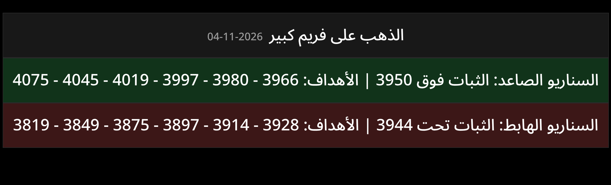

# صفقات الذهب اليومية

ترسل صورة الصفقات (نفس التصميم) كل يوم الساعة **3:00 الفجر بتوقيت الكويت** على **واتساب** عن طريق GitHub Actions.



## الإعداد (مرة وحدة)
1. سجّل في [green-api.com](https://green-api.com) وسوِّ Instance مجاني (Developer).
2. من لوحة التحكم امسح الـ QR بواتساب (الإعدادات ← الأجهزة المرتبطة ← ربط جهاز).
3. انسخ من صفحة الـ Instance: `idInstance` و `apiTokenInstance` و `mediaUrl`.
4. في GitHub: **Settings → Secrets and variables → Actions → New repository secret**، وأضف:
   | الاسم | القيمة |
   |---|---|
   | `GREEN_API_INSTANCE_ID` | idInstance |
   | `GREEN_API_TOKEN` | apiTokenInstance |
   | `GREEN_API_MEDIA_URL` | mediaUrl (مثل `https://7103.media.greenapi.com`) |
   | `WHATSAPP_CHAT_ID` | رقمك بدون + مثل `96512345678`، أو قروب `...@g.us`، ولأكثر من واحد افصل بفاصلة |
5. للتجربة الحين: **Actions → Daily gold signal → Run workflow**.
6. **ادمج الفرع في main** عشان يشتغل التشغيل اليومي (GitHub ما يجدول إلا من الفرع الرئيسي).

> تيليجرام لا يزال مدعوم اختيارياً: أضف `TELEGRAM_BOT_TOKEN` و `TELEGRAM_CHAT_ID` إذا تبي الاثنين.

## تعديل منطق المؤشر
المعادلة موجودة في `gold_signals/levels.py`. المعادلة الحالية مستنتجة من الصورة
(أهداف تبعد 16 / 30 / 47 / 69 / 95 / 125 نقطة عن نقطة الثبات).
استبدلها بمعادلة مؤشرك الحقيقية.

## تشغيل محلي
```bash
pip install -r requirements.txt && python -m playwright install chromium
MANUAL_PRICE=3947 python -m gold_signals.main   # يحفظ signal.png
```
